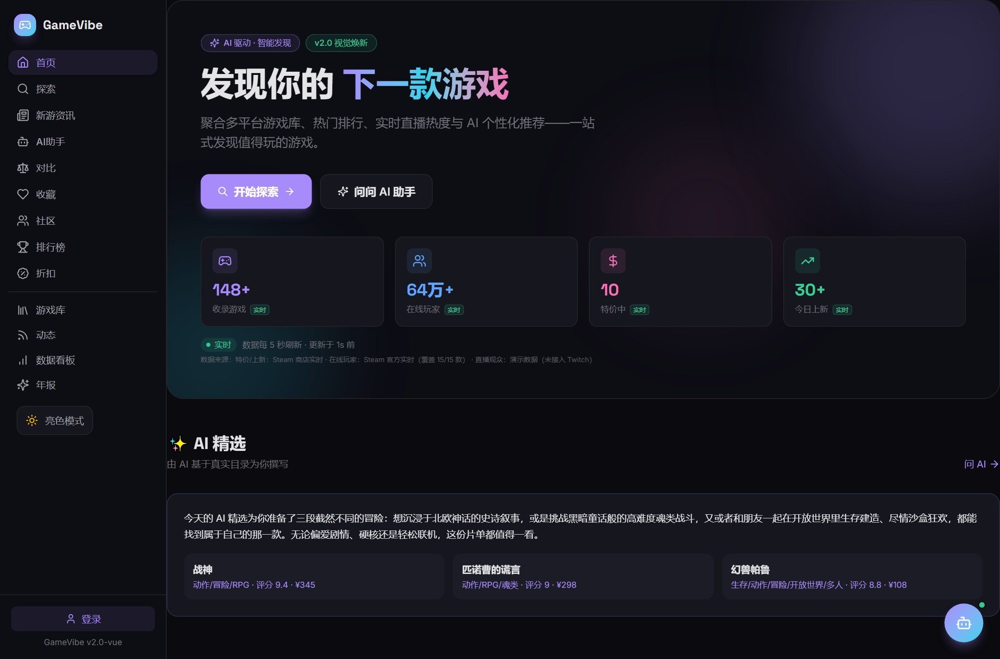
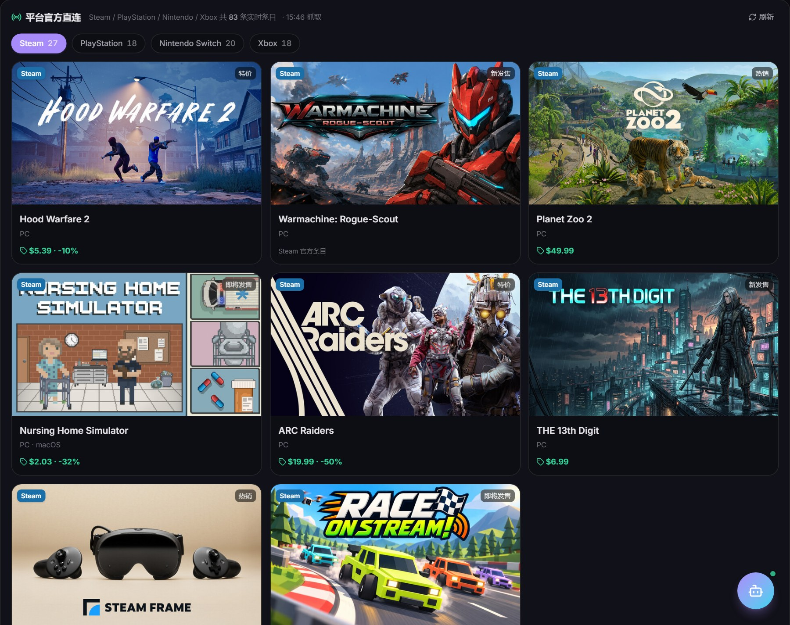
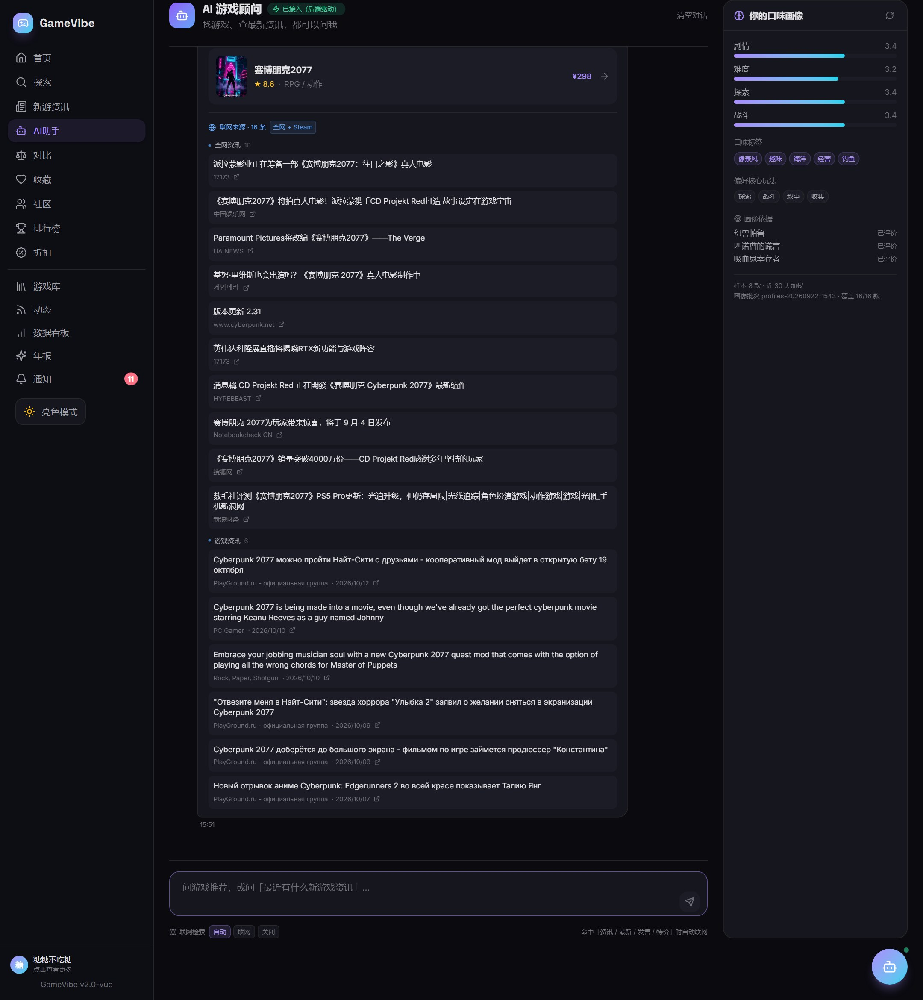
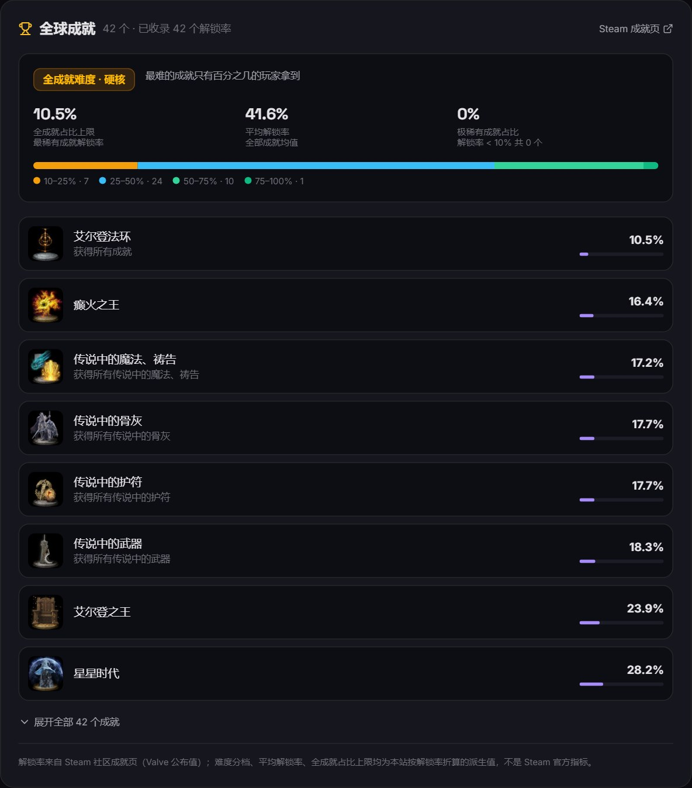

<div align="center">

# GameVibe · 跨平台游戏发现与口碑平台

**Vue 3 + TypeScript + Hono + SQLite 的全栈游戏发现平台**<br />
多平台官方接口直连 · AI 助手（防幻觉设计）· 真实评测与成就数据 · 一键单端口部署

[](https://vuejs.org)
[](https://vite.dev)
[](https://www.typescriptlang.org)
[](https://tailwindcss.com)
[](https://hono.dev)
[](https://nodejs.org)
[](https://nodejs.org/api/sqlite.html)

**[🔗 Live Demo](https://7fe3227e96e54b979531a0c7f7024f34.app.workbuddy.host/)** · [中文说明](#-中文说明) · [Screenshots](#-screenshots)

</div>

---

## What is this

GameVibe is a **complete, deployable full-stack game-discovery platform** — not a UI mockup. It aggregates real game data straight from the official Steam / PlayStation / Nintendo / Xbox endpoints, layers an LLM assistant on top of it, and is honest about what it cannot get.

The guiding rule of the whole project: **the model never touches facts.** Every title, date, number and link the AI appears to "know" is injected back by the backend from a real data source. When a source is unreachable, the product says so instead of filling the gap with invented content — there is no mock-data fallback anywhere in the codebase.

> Built through "Vibecoding": requirements were driven in natural language and delivered iteratively by an AI pair-programmer, with every claim verified against live endpoints and real browser runs.

### Highlights

| | |
|---|---|
| 🛰️ **4 platforms, real data** | Steam · PlayStation · Nintendo · Xbox official endpoints — all keyless, 10-min TTL cache, per-platform failure isolation |
| 🧠 **Anti-hallucination AI** | 3 structural patterns (citation / numeric / link back-fill) so the model can never fabricate a fact |
| 🏆 **Global achievement board** | Real unlock rates parsed from Steam Community, graded into 5 difficulty tiers |
| 🚫 **No fake data, ever** | Unavailable ⇒ `available: false` + a human-readable reason. Mock fallbacks were deliberately deleted |
| 🗄️ **Zero-dependency backend** | Node's built-in `node:sqlite`, JWT + scrypt, SSE streaming — no Postgres, no Redis, no ORM |
| 📦 **One process = whole app** | The same server hosts the API and the built SPA; Dockerfile included |

---

## 📸 Screenshots

<div align="center">

**Home — first screen (AI picks & daily trend are above the fold, no login required)**



**Explore — direct-from-platform cards (real covers, per-platform tabs)**



**AI assistant — live web retrieval; every title, date and link is back-filled verbatim from the upstream source**



**Game detail — global achievement difficulty board**



</div>

---

## 🏗 Architecture

```
┌───────────────────────────────────┐        ┌─────────────────────────────────────────┐
│  Frontend — Vue 3 + TS + Vite 6   │  HTTP  │  Backend — Hono on Node 22/24           │
│  Pinia · Vue Router · Tailwind v4 │ ─────▶ │  node:sqlite (WAL) · JWT + scrypt       │
│  ECharts · lucide-vue-next        │  /api  │  SSE streaming · tiered rate limiting   │
│  dark / light themed              │ ◀───── │  security headers · request caching     │
└───────────────────────────────────┘        └────────────────────┬────────────────────┘
                        │                                           │
               dist/ (static SPA)              keyless upstreams: Steam · PlayStation ·
            served by the same process         Nintendo · Xbox · Serper / Tavily (optional)
```

**Frontend** — Vue 3 SFC with `<script setup lang="ts">`, strict TypeScript, Pinia stores (game / auth / theme / toast), lazy-loaded routes, Tailwind v4 design tokens for a dark+light theme, ECharts dashboards, SSE-consumed AI chat.

**Backend** — Hono with per-route auth middleware, `node:sqlite` in WAL mode (schema auto-created and idempotently migrated on boot), scrypt password hashing, JWT, tiered rate limits (`10/min` auth, `20/min` chat, `60/min` read), security headers, SPA fallback hosting.

---

## 🧠 The interesting part: an AI that cannot lie

The LLM is used for judgement and prose only. Facts are assembled by the backend:

1. **Citation back-fill** — reviews are handed to the model as numbered items with no author names; the model returns only an array of indices. Quote text is resolved locally against the database.
2. **Numeric injection** — for the daily trend, the model writes a qualitative read; every number (player counts, discount %, record highs) is injected afterwards from the live snapshot. Model-emitted digits are rejected — with an exemption list so titles like *Cyberpunk 2077* or *CS2* don't trip it.
3. **Link back-fill** — for news retrieval the model writes a Chinese summary; titles, dates and URLs are all re-attached from the fetched source objects. The prompt forbids URLs, and an assertion fails the build if the summary contains `http`.

**Retrieval boundaries, stated honestly.** The keyless upstreams can search games *by name* but not *by tag* — so pure taste queries ("I like pixel-art indies") are answered from the local catalogue mapping rather than the web, and the UI explains why. When retrieval returns nothing, the assistant falls back to catalogue recommendations and prefixes the reply with an explicit "retrieval currently unavailable" note.

**Data provenance is visible.** `/api/live` returns a `real` flag per metric; the UI renders a "live" or "demo" badge accordingly. The one metric that has no real source (concurrent Twitch viewers — Twitch OAuth is blocked in this environment) is always shown as demo, and the "直播观众" dashboard card was removed rather than kept as decoration.

---

## 🛰️ How the multi-platform layer works

| Platform | Endpoint | Notes |
|---|---|---|
| **Steam** | `featuredcategories` + `appdetails` | four buckets merged **interleaved** so the first row isn't all-discounts |
| **PlayStation** | `web.np.playstation.com` (chihiro GraphQL) | `NEWGAMES` container + 10 keyword searches merged by `release_date desc` |
| **Nintendo** | `search.nintendo-europe.com` | ±180-day window, **sorted locally** (the API ignores `sort` when a range is passed) |
| **Xbox** | `displaycatalog.mp.microsoft.com` | `$top=25` hard limit; only `Poster` / `BrandedKeyArt` / `BoxArt` artworks are shown |

Each client has a 10-minute TTL cache (**failures are never cached**), independent failure isolation, and returns `ok: false` with a Chinese reason. A dead platform shows an amber notice and an empty block — it is never filled with data from somewhere else. Each response also carries an `artRatio` so a given tab renders at a 100 %-consistent aspect ratio with zero cropping (portrait vs. landscape layouts switch automatically).

Cover art is normalised per platform: Steam's `library_600x900_2x` (the non-`_2x` file is only 300×450 despite its name), PlayStation's 1024×1024 square key art, Nintendo's 500×500, Xbox's 600×900 poster.

### Steam app-id table

Everything Steam offers (reviews, achievements, player counts) is indexed by `appid`, while the app uses its own ids. The mapping table is **85 entries, each individually verified** by calling `appdetails` and reading the returned name back. An earlier hand-written table contained five title/`appid` mismatches that caused the detail page to display *another game's* data — that class of bug is worse than missing data, so the table is now generated and audited by script (`scripts/auditSteamAppIds.mjs`), and `resolveSteamAppId()` returning `null` is treated as "this game genuinely has no Steam data".

---

## 🚀 Quick start

Requires **Node ≥ 22** (≥ 24 recommended).

```bash
npm install
cp .env.example .env        # optional: add LLM / search keys

npm run server              # API on :8792 (auto-creates schema + seeds demo data)
npm run dev                 # frontend on :5173, proxies /api → 8792
```

Open <http://localhost:5173>. On first boot the backend detects an empty `users` table and seeds 12 demo players (reviews, follows, libraries) — no manual step needed.

**Demo accounts**

```
email:    <any seed username>@seed.local     e.g. 糖糖不吃糖@seed.local
password: seedpass1234
```

Environment variables (all optional — the app degrades gracefully without them):

| Variable | Purpose |
|---|---|
| `JWT_SECRET` | token signing |
| `DEEPSEEK_API_KEY` / `AI_BASE_URL` / `AI_MODEL` | LLM for the AI assistant |
| `SERPER_API_KEY`, `TAVILY_API_KEY` | optional web search (Serper first, Tavily fallback, then Steam) |
| `SERVER_PORT` | defaults to `8792` |
| `CORS_ORIGIN` | comma-separated allow-list |

---

## 📦 Build & deploy

```bash
npm run build               # vue-tsc typecheck + vite build → dist/
npm run server              # API + SPA on one port
```

Because the server also hosts `dist/`, a single process serves the whole app (with SPA fallback). Docker is wired up:

```bash
docker build -t gamevibe .
docker run -d --env-file .env -p 8792:8792 gamevibe
```

On any container host: build `npm install && npm run build`, start `node --no-warnings server/index.ts`, expose port `8792`, and set the env vars above. Outbound-network policy matters — the app ships `/api/diag/egress`, `/api/diag/realtime` and `/api/diag/providers` endpoints that classify each upstream as `healthy` / `needsAuth` / `blocked`, because an unreachable endpoint and a missing credential look identical from the UI otherwise.

---

## 🧪 Quality gates

No test framework — instead, self-contained verification scripts driven by a real browser and real endpoints:

| Script | Checks |
|---|---|
| `verifyAchievements.mjs` | 32 assertions: positive-rate equals the true ratio, legacy wrong app-ids resolve to *this* game, no `source:'mock'` anywhere |
| `verifyRealtime.ts` | 24 assertions on the live-metric layer and its `real` flags |
| `smokeAI.ts` | 23 end-to-end AI assertions (with 429 back-off) |
| `verifyExploreUI.mjs` | explore page: card count, broken-image count, image resolution |
| `verifyFirstScreen.mjs` | AI features genuinely visible above the fold, logged out |
| `auditSteamAppIds.mjs` | re-verifies the whole app-id table against Steam |

Type safety: `npm run server:typecheck` plus `vue-tsc` during build, both clean.

---

## 📄 License

MIT for the application code. Game artwork, names and achievement data belong to their respective publishers and are fetched from official public endpoints at runtime for display purposes only.

---

# 📖 中文说明

<div align="right"><a href="#gamevibe--跨平台游戏发现与口碑平台">↑ 回到顶部（英文版）</a></div>

## 这是什么

GameVibe 是一个**前后端分离、带真实数据库与鉴权、可直接上线**的游戏发现与口碑平台，不是一个套壳 demo。它把 Steam / PlayStation / Nintendo / Xbox 的官方接口直连起来，上面叠一层 AI 助手，并且对「拿不到的数据」说实话。

贯穿全项目的原则只有一条：**模型不碰事实**。AI 说出口的每一个标题、日期、数字、链接，都由后端从真实数据源回填；某个数据源不可达时，产品如实说明，而不是编内容顶上——代码库里**不存在任何 mock 兜底**。

## 功能一览

| 模块 | 能力 |
|---|---|
| **首页看板** | 收录量 / 在线玩家 / 特价中 / 今日上新四张实时卡（逐指标标「实时」或「演示」） |
| **AI 精选 + AI 今日趋势** | 首屏可见、不依赖登录；趋势文案定性、数字全部本地注入 |
| **多平台探索** | 四平台官方直连卡带，132 款多平台游戏 + 16 款精选库，搜索 / 类型 / 平台 / 价格筛选 |
| **游戏详情** | 封面、评分雷达、Metacritic、开发商、平台标签、收藏 / 愿望单 / 对比 |
| **玩家口碑** | 站内评测 CRUD + Steam 评测聚合（好评率取真实比值），AI 口碑摘要走引用回填 |
| **全球成就榜** | 中文成就名 / 描述 / 图标 + 全球解锁率 + 五档难度分档 |
| **AI 顾问** | SSE 流式对话、`auto/on/off` 三态联网、真实资讯来源卡片 |
| **个人数据** | 我的评测、库存在玩 / 通关 / 想玩、游戏年报 Wrapped（分步揭晓 + 导出 PNG） |
| **社交** | 关注 / 取关、用户主页、好友动态流（未关注时降级为全站发现流） |
| **账号体系** | 注册 / 登录（JWT + scrypt）、收藏 / 愿望单 / 最近浏览持久化 |
| **明暗主题** | 全站双主题，设计令牌驱动 |

## 三个「不做假」的工程决定

**一、AI 防幻觉：三种本地回填。**
口碑摘要把评论变成带序号、匿名的条目喂给模型，模型只回序号数组，引文由本地按序号回填；趋势文案只让模型写定性判断，所有数字从 `/api/live` 快照注入，并检测模型输出中的数字（豁免目录内的游戏名，避免误伤「赛博朋克2077」）；联网检索只让模型写中文简报，标题 / 日期 / 链接全部由后端回填，prompt 明令禁止 URL，并断言正文不含 `http`。

**二、删除全部 mock 兜底。**
早期版本里有一个包含 7 款游戏「仿真评论」的 mock 库（带伪造作者名、游玩时长、正文）和一套随机生成好评率的兜底函数。它们在细节上太像真的，一个「模拟数据」小角标抵不掉误导风险，已整体删除。现在的口径是：评测与成就端点**恒返回 200**，用 `available` / `ok` 字段 + 中文 `reason` 说明取不到的原因，前端显示琥珀提示条，不拿占位内容凑数。

**三、好评率必须用真实比值。**
Steam 另有一个 0–9 档的 `review_score`，折算成百分比会和同一张卡面上展示的 `227.1K / 250.4K`（90.7%）对不上，一眼假。所以一律用 `total_positive / total_reviews`，0–9 档只在缺前者时兜底。

## 数据来源与相关性边界

四平台全部使用**免密钥**官方接口（见上文英文表格），各自 10 分钟 TTL 缓存、**失败不缓存**、平台间独立降级。国内 / 沙箱环境的出网情况与线上差异很大，因此出网探测一律走 `/api/diag/egress` 实时判定，并把结果分成三档：`healthy`（通）、`needsAuth`（网络通但缺凭证，401/403）、`blocked`（连不上）——把 401 误读成「被墙」正是早期一次误判的根因。

免密钥检索接口的一个真实限制：**只能按名字搜，不能按标签搜**。用 `term=pixel` 查会返回《Pixel Gun 3D》而不是《星露谷物语》。因此纯口味型提问不搜全网，改走站内标签映射，避免拿噪声结果糊弄用户——这条边界在 UI 上也是明说的。

## 本地运行

```bash
npm install
cp .env.example .env          # 可选：填 LLM / 搜索 key

npm run server                # 后端 :8792（首次启动自动建表 + 播种演示数据）
npm run dev                   # 前端 :5173，/api 代理到 8792
```

演示账号：`<任意种子用户名>@seed.local`（例：`糖糖不吃糖@seed.local`），密码 `seedpass1234`。

> **本机开发提示**：如果所在网络需要代理才能访问外网，Node 直连 Steam 可能被墙，需要在启动后端时临时注入 `HTTPS_PROXY` 与 `NODE_USE_ENV_PROXY`。这两个变量**不要写进 `.env`**（会被带到线上并干扰 LLM 出口）。相关排查经验全部记在 `docs/` 下。

## 目录结构

```
gamevibe/
├── src/                      # 前端
│   ├── pages/                # Home / Explore / GameDetail / AIAssistant / Wrapped / Social ...
│   ├── components/           # Layout / PlatformGameCard / AchievementBoard / ShareCard ...
│   ├── stores/               # Pinia: game / auth / theme / toast
│   ├── lib/                  # api / platformApi / liveApi / echarts
│   └── data/                 # 精选库 + 静态部署兜底目录
├── server/                   # 后端
│   ├── index.ts              # Hono 入口（安全中间件 + 分级限流 + 静态托管）
│   ├── db/                   # schema / 连接（WAL + 幂等迁移）
│   ├── lib/                  # platformCatalog / steamRealtime / steamReviews /
│   │                         # steamAchievements / steamAppIds / webSearch / trend ...
│   ├── routes/               # auth / games / reviews / live / ai* / social / stats / diag
│   └── data/                 # 132 款多平台目录
├── scripts/                  # 生成器、审计器、回归脚本、截图探针
└── docs/                     # 设计文档、约束说明、评测报告、截图
```

## 质量保障

没有引入测试框架，而是用真实浏览器 + 真实接口驱动的自包含回归脚本：成就榜 32 条断言、实时数据层 24 条、AI 端到端 23 条，外加探索页卡片 / 破图检查、首屏 AI 可见性检查、appid 全表重审计。类型检查（`tsc` + `vue-tsc`）全绿。

## 许可

应用代码 MIT。游戏美术、名称与成就数据版权归各自发行商所有，本项目仅在运行时从官方公开接口获取并用于展示。

---

<div align="center">

_由玩家 **曦** 与 AI 伙伴 **析** 通过 Vibecoding 共同打造。_

</div>
